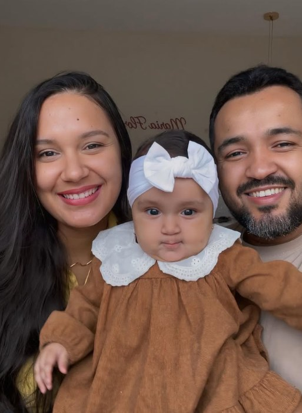

# Convite 1 Aninho — Maria Flor

Convite online para o 1 aninho da Maria Flor (13/12/2026 · Espaço da Festa, Teresina-PI).

## Estrutura
```
├── index.html   ← página única (HTML + CSS + JS)
├── favicon.svg
└── img/
    ├── foto1.jpg  ← foto de destaque (herói)
    ├── foto2.jpg  ← galeria (2) — também fundo da seção de vestuário
    ├── foto3.jpg  ← galeria (3)
    └── foto4.jpg  ← galeria (4)
```

## Como trocar as fotos
1. Salve as fotos na pasta `img/` com os nomes acima (JPG, preferencialmente retrato).
2. No `index.html`, substitua cada bloco `<span class="foto-placeholder">…</span>` por:
   ```html
   
   ```
   (o destaque do herói não precisa do `loading="lazy"`).
3. Ative o fundo da seção de vestuário removendo o comentário:
   `background:linear-gradient(#663946e0,#663946e0),url(img/foto2.jpg) 50% 23%/cover fixed;`
4. Preencha o array `FOTOS` no final do `<script>` (o lightbox já lê dele).

## Dados editáveis
Todos no bloco `CONFIG` dentro do `index.html`:
- `dataFesta` — data/hora (recalcula contagem, carimbo e rodapé)
- `linkFormPresenca` — Google Forms de confirmação de presença
- `linkMapa` — botão "Ver no mapa" + QR code
- `musicaSrc` / `musicaNome` — música em MP3 (pasta `audio/`)
